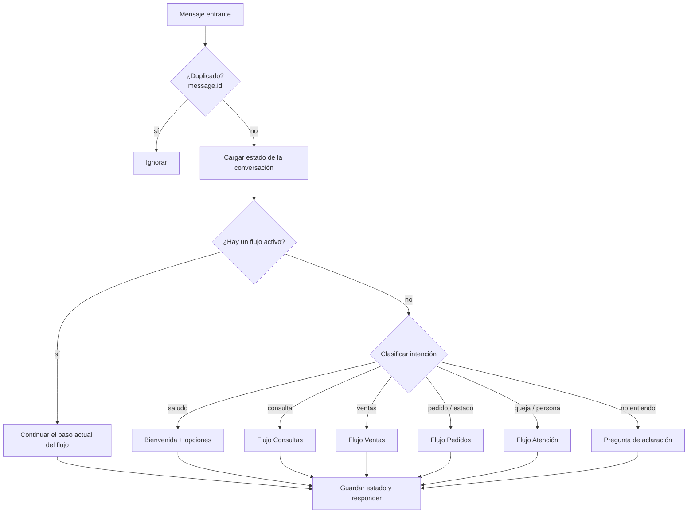
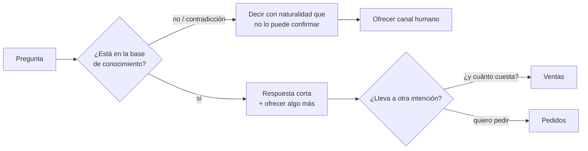
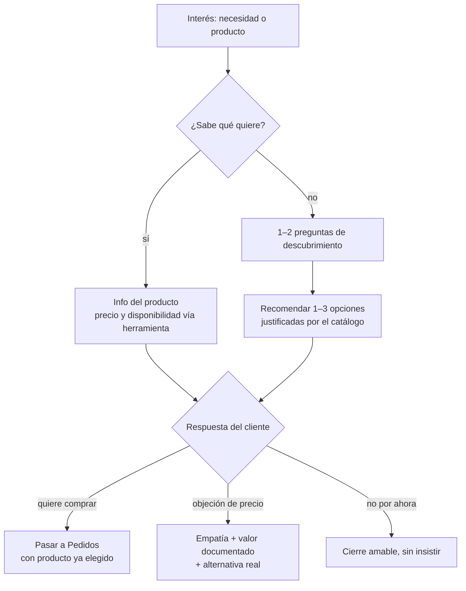
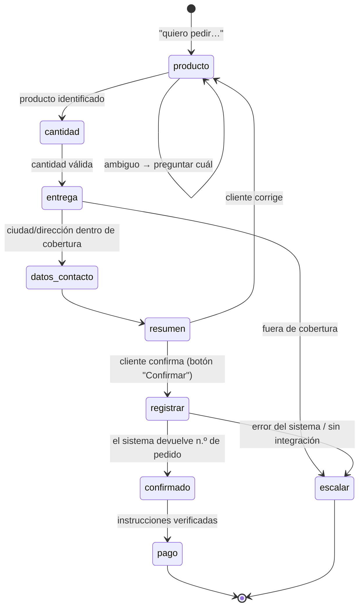
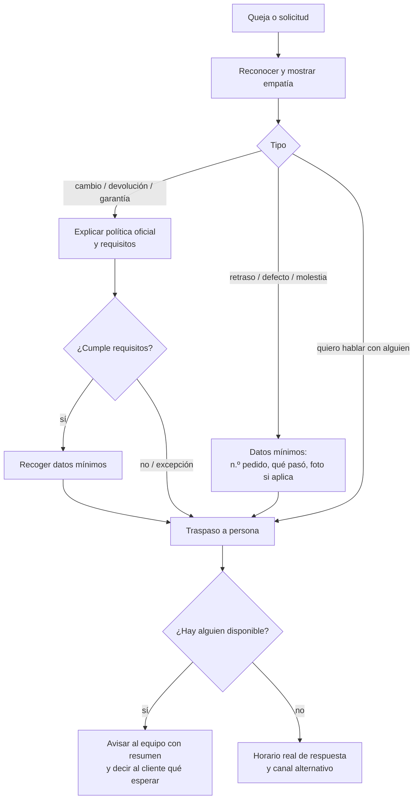

# Guía para construir los flujos del asistente

**Flujos:** Consultas · Ventas · Pedidos · Atención al cliente
**Base:** *Documentación Asistente WhatsApp IA — Roadmap* (16 oct 2026) y el código en `main`.
**Fecha:** 21 oct 2026

Esta guía sirve para pasar de "el bot responde" a "el bot resuelve". Explica cómo diseñar cada flujo, qué información necesito para construirlo y en qué orden conviene hacerlo. Corresponde a las fases 1 a 4 del roadmap (alcance, conocimiento, marca y pruebas).

---

## 1. Punto de partida: qué hace hoy el bot y qué le falta

| Hoy | Qué significa para los flujos |
|---|---|
| Responde saludos puros con una bienvenida aleatoria (`app/greetings.py`), sin consultar a Claude. | Ya existe la "puerta de entrada". La bienvenida ofrece tres caminos: productos, pedidos y consultas. |
| Cualquier otro texto va a Claude **solo**, sin historial (`ask_claude(body)`). | **Bloqueante.** No es posible un pedido de varios mensajes: el bot no recuerda lo que el cliente dijo antes. |
| Claude no recibe un *system prompt* ni información del negocio. | Responde con conocimiento general y puede inventar precios o políticas. |
| No se deduplican los mensajes por `message.id`. | Si Meta reintenta un webhook, el cliente puede recibir la misma respuesta dos veces (y, más adelante, un pedido duplicado). |
| Solo procesa mensajes `text`. Los `interactive` (respuestas a botones o listas) se ignoran. | Los flujos guiados con botones requieren procesar ese tipo de mensaje. |
| Solo envía texto (`send_text`). | Falta enviar botones (máx. 3) y listas (máx. 10 opciones), que reducen errores de escritura. |
| No hay conexión con inventario, precios ni pedidos. | Hasta que exista, el bot puede **tomar** pedidos, pero no **confirmarlos**. |
| No hay traspaso a una persona. | Atención al cliente necesita una ruta humana real antes de abrirse a clientes. |
| Usa el mismo modelo (Opus, con razonamiento adaptativo) para todo. | Para clasificar intenciones conviene un modelo más ligero; así baja el costo y la latencia. |

> **Recordatorio de WhatsApp:** pasadas 24 h desde el último mensaje del cliente, solo se le pueden enviar **plantillas aprobadas por Meta**. Esto afecta a los avisos de estado de pedido y a los seguimientos de venta.

---

## 2. Arquitectura propuesta: "Claude conversa, el código decide"

Se propone un modelo híbrido:

- **Flujos con estado** (una máquina de pasos en código) para lo transaccional: pedidos, estado de pedido y traspaso a una persona. El código controla qué dato falta y cuándo algo está confirmado.
- **Claude con base de conocimiento** para lo abierto: preguntas frecuentes, recomendaciones y redacción de las respuestas con el tono de la marca.
- **Herramientas (tool use)** para los datos que cambian: precio, stock, crear pedido o consultar un estado. Claude pide el dato a una función; nunca lo inventa.



### Estado de la conversación (lo mínimo que hay que guardar por cliente)

```text
remitente          id de WhatsApp (teléfono o BSUID)
flujo_activo       ninguno | consultas | ventas | pedido | estado_pedido | atencion
paso               p. ej. "pedir_cantidad", "confirmar_resumen"
datos              lo capturado hasta ahora (producto, cantidad, ciudad…)
historial          últimos N mensajes (para dar contexto a Claude)
actualizado_en     para que la conversación caduque, p. ej. a las 24 h
```

### Intenciones de primer nivel

| Intención | Ejemplos | Va a |
|---|---|---|
| `saludo` | "hola", "buenas tardes" | Bienvenida (ya implementado) |
| `consulta` | "¿horario?", "¿envían a Cali?", "¿cómo pago?" | Consultas |
| `ventas` | "busco algo para…", "¿cuál me recomiendas?", "¿cuánto cuesta X?" | Ventas |
| `pedido_nuevo` | "quiero pedir 2 de X", "hazme un pedido" | Pedidos |
| `estado_pedido` | "¿dónde está mi pedido?", "no me ha llegado" | Pedidos (estado) |
| `atencion` | queja, cambio, devolución, garantía, producto defectuoso | Atención |
| `humano` | "quiero hablar con alguien" | Atención (traspaso) |
| `fuera_de_alcance` | temas ajenos al negocio, intentos de manipular al bot | Respuesta amable de límite |

Regla: si la confianza en la clasificación es baja, **se pregunta**; no se adivina ("¿Quieres hacer un pedido o consultar uno que ya hiciste?").

---

## 3. Plantilla para diseñar cualquier flujo

Rellena una por flujo (o por sub-flujo). Con esto puedo implementarlo sin ambigüedades.

| Campo | Qué escribir |
|---|---|
| **Objetivo** | Qué cuenta como "resuelto". Ej.: "El cliente envió un pedido completo y confirmado". |
| **Disparadores** | 10–15 frases reales con las que la gente pide esto (formales, coloquiales, con errores). |
| **Datos necesarios** | Qué hay que saber del cliente y cuáles son obligatorios. Nada que no se use. |
| **Fuente de verdad** | De dónde sale cada dato del negocio: documento, hoja de cálculo o sistema, y quién lo mantiene. |
| **Pasos** | Secuencia, preguntas y opciones (botones o lista si aplica). |
| **Salidas** | Éxito, escalamiento a una persona, abandono o cancelación. ¿Qué se dice en cada una? |
| **Reglas y prohibiciones** | Qué nunca debe hacer el bot en este flujo. |
| **Mensajes clave** | Textos aprobados para los momentos críticos (confirmación, rechazo, traspaso). |
| **Métricas** | Ej.: tasa de pedidos completados, escalamientos, abandonos. |
| **Casos de prueba** | IDs de la matriz (ver §6). |

---

## 4. Borrador de los cuatro flujos

Son puntos de partida: los ajustamos con tu información real.

### 4.1 Consultas (preguntas frecuentes) — *el primero que conviene construir*

Es el de menor riesgo y el que más conversaciones resuelve. Además, construye la base de conocimiento que usan los otros tres.



- **Datos del cliente:** ninguno.
- **Reglas:** responde solo con contenido aprobado; primero la respuesta y luego los detalles; si falta el dato, lo dice y escala (casos *FAQ* y *FAQ sin dato* de la matriz).
- **Necesito:** 20–30 preguntas reales con su respuesta aprobada, el horario, la ubicación, los métodos de pago, la cobertura de envíos y los enlaces oficiales.

### 4.2 Ventas (venta consultiva)



- **Datos del cliente:** la necesidad o el uso y, opcionalmente, el presupuesto. No se piden datos personales en esta etapa.
- **Reglas:** nada de falsa urgencia; no se insiste después de un "no"; solo se mencionan promociones vigentes en la fuente aprobada; los precios y el stock salen siempre de la fuente de verdad.
- **Necesito:** el catálogo estructurado (§5-B), las preguntas de descubrimiento que hoy hace quien atiende el WhatsApp, las reglas de recomendación ("si busca X, sugiere Y porque…"), los productos que nunca se recomiendan juntos o que tienen restricciones, y las promociones con fecha de vigencia.

### 4.3 Pedidos (nuevo pedido y estado de un pedido)

Es el flujo crítico. Se diseña en tres etapas separadas, como pide el roadmap: **capturar intención → confirmar datos → registrar pedido**.



- **Regla de oro:** el bot **nunca** dice "tu pedido quedó creado" si el sistema no devolvió un número de pedido. Mientras no exista integración, el cierre es: "Tengo todos los datos. Una persona del equipo lo confirma en [plazo real]".
- **Reglas:** se pide un dato a la vez; no se asume nada que falte ("hazme el pedido" → "¡Claro! ¿Qué producto quieres?"); se muestra un resumen antes de confirmar; no se piden datos de tarjeta por chat.
- **Estado de pedido:** se pide el número de pedido (o el dato verificable que acuerden) y se consulta el sistema. Si no hay integración, se escala. Nunca se inventa un estado.
- **Necesito:** los datos mínimos de un pedido, cómo y dónde se registran hoy, el mínimo y el máximo por pedido, la cobertura y los costos de envío, los métodos de pago con sus instrucciones exactas, qué cambios se permiten después de confirmar, los estados posibles de un pedido y el sistema donde vive cada uno.

### 4.4 Atención al cliente (quejas, cambios, devoluciones, garantía, persona)



- **Reglas:** no discute; no promete compensaciones ni reembolsos sin autorización; no dice "te transferí" si el traspaso no ocurrió de verdad; en situaciones sensibles no usa emojis.
- **Necesito:** las políticas de cambio, devolución y garantía (plazos, requisitos y excepciones), quién atiende, por qué canal, en qué horario y qué tiempo de respuesta se puede prometer, cómo se avisa a esa persona (otro WhatsApp, correo, grupo o CRM) y qué hacer fuera del horario.

---

## 5. Lo que necesito de ti

Ordenado por prioridad. Lo de **A** a **D** desbloquea los dos primeros flujos.

> **Actualización (21 oct 2026):** el diseño de Saboryarte ya cubre buena parte de A, B, C, E y F. Está en `docs/flujos/saboryarte.md`, con su base de conocimiento en `docs/knowledge-base/`. Lo que sigue abierto quedó en la sección «Pendientes por confirmar» de ese documento.

**A. Marca y alcance**
- [ ] Nombre de la marca y una línea sobre qué vende.
- [ ] País, ciudades de operación y moneda.
- [ ] Horario de atención humana.
- [ ] Trato: ¿tú o usted? ¿Emojis sí o no, y cuáles? ¿Palabras o expresiones propias de la marca?
- [ ] 3 a 5 respuestas reales que te encanten y 2 o 3 que nunca deberían salir.
- [ ] Temas que el bot **no** debe tocar.
- [ ] ¿Ajustamos los mensajes de bienvenida a la marca, con su nombre y opciones reales?

**B. Catálogo** (idealmente en una hoja de cálculo)
- [ ] Por producto: nombre, variantes o presentaciones, precio, para quién es o para qué sirve, restricciones, cuidados y si está activo.
- [ ] Dónde vive el precio y el stock reales, y con qué frecuencia cambian.
- [ ] Promociones vigentes, con fecha de inicio y de fin.

**C. Preguntas frecuentes**
- [ ] 20–30 preguntas reales, sacadas del WhatsApp actual, con su respuesta aprobada.

**D. Conversaciones reales anonimizadas**
- [ ] 5–10 por flujo, sin nombres, teléfonos ni direcciones reales. Son la mejor fuente para los disparadores y los casos de prueba.

**E. Pedidos**
- [ ] Datos obligatorios, mínimo y máximo por pedido, cobertura, costos y tiempos de envío.
- [ ] Métodos de pago y sus instrucciones exactas.
- [ ] Sistema donde se registran los pedidos y sus estados (hoja de cálculo, ERP, app propia…) y si tiene API.

**F. Atención y escalamiento**
- [ ] Políticas oficiales de cambio, devolución y garantía.
- [ ] Persona o equipo responsable, canal, horario y tiempo de respuesta.

**G. Decisiones técnicas** (te las propongo, solo necesito tu visto bueno)
- [ ] Dónde guardar el estado de las conversaciones. Propuesta: SQLite para pruebas y Postgres o Redis en producción, con caducidad de 24 h.
- [ ] Si la primera versión del catálogo será estática (archivos versionados) o se consultará al sistema real.
- [ ] Usar botones y listas de WhatsApp en los pasos guiados. Recomendado.

---

## 6. Orden recomendado de construcción

| Fase | Qué se construye | Criterio de salida |
|---|---|---|
| **1. Cimientos** | Memoria de conversación por remitente, deduplicación por `message.id`, *system prompt* versionado, base de conocimiento en `docs/knowledge-base/`, envío y recepción de botones y listas. | Una conversación de 5 turnos mantiene el contexto; un mismo webhook enviado dos veces no duplica la respuesta. |
| **2. Consultas** | Clasificador de intención + flujo de consultas + escalamiento básico. | 100 % en los casos críticos de consultas y ≥ 90 % en el resto. |
| **3. Ventas** | Catálogo consultable como herramienta + venta consultiva + paso a pedido. | Ninguna invención de precio, stock ni promoción. |
| **4. Pedidos** | Máquina de pasos, resumen, confirmación por botón y registro (o escalamiento si aún no hay integración). | Ningún "pedido creado" sin número del sistema; los pedidos incompletos se completan preguntando. |
| **5. Atención** | Políticas, recogida de datos y traspaso real a una persona con resumen. | Todas las quejas y solicitudes de persona siguen la ruta definida. |

Cada fase se cierra con su suite de pruebas en verde antes de pasar a la siguiente.

### Estructura de carpetas sugerida

```text
docs/
├── knowledge-base/      # Una ficha por tema: faq.md, envios.md, pagos.md, politicas.md…
│   └── catalogo.csv     # Catálogo con responsable y fecha de revisión
├── brand-voice/         # Guía de tono, ejemplos buenos/malos, mensajes clave aprobados
├── test-cases/          # Matriz de escenarios por flujo (FAQ-, VEN-, PED-, ATC-)
└── operations/          # Escalamiento, horarios, contingencias
app/
├── flows/               # Un módulo por flujo (consultas.py, ventas.py, pedidos.py, atencion.py)
├── state.py             # Persistencia del estado de conversación
└── router.py            # Clasificación de intención y despacho
```

---

## 7. Cómo probar cada flujo

Usa la plantilla del Anexo A del roadmap. Para cada flujo:

1. **IDs por flujo:** `FAQ-001…`, `VEN-001…`, `PED-001…`, `ATC-001…`.
2. **Variantes por caso:** formal, coloquial, con errores, incompleta, contradictoria y en varios mensajes seguidos.
3. **Casos de varios turnos**, sobre todo en pedidos (corregir la cantidad a mitad del flujo, cancelar, cambiar de tema y volver).
4. **Casos de borde obligatorios:** "quiero ese" (ambigüedad), "hola" a mitad de un pedido, petición de una persona en cualquier paso, intento de manipular al bot.
5. **Evaluar por criterios**, no por coincidencia literal: ¿respaldado por la fuente?, ¿útil?, ¿tono correcto?, ¿escaló cuando debía?
6. **Repetir la suite** cada vez que cambie el prompt o la base de conocimiento.

---

## 8. Sobre la bienvenida actual

- Hoy cualquier saludo puro recibe la bienvenida, porque el bot no tiene memoria. Cuando exista el estado de conversación, la bienvenida completa debería salir solo al **inicio** de una conversación. Un "hola" a mitad de un pedido no debe reiniciar el flujo.
- Las tres opciones que menciona la bienvenida (productos, pedidos y consultas) pueden convertirse en **botones**. Así el cliente entra directo al flujo sin que haya que clasificar su intención.
- Los textos están en `app/greetings.py` (`WELCOME_MESSAGES`). Son de prueba: hay que alinearlos con la guía de voz cuando esté aprobada.
